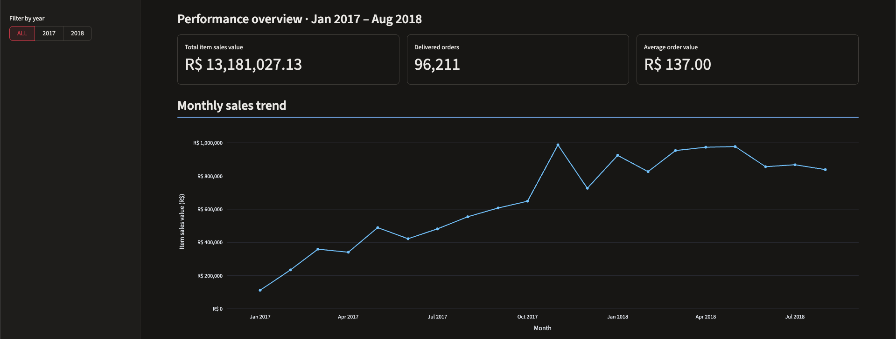
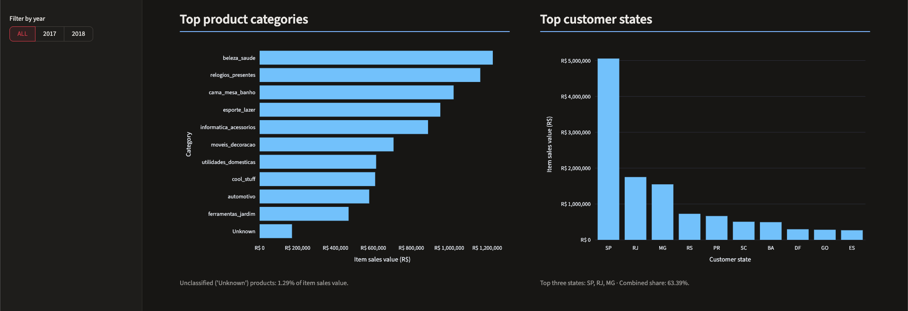
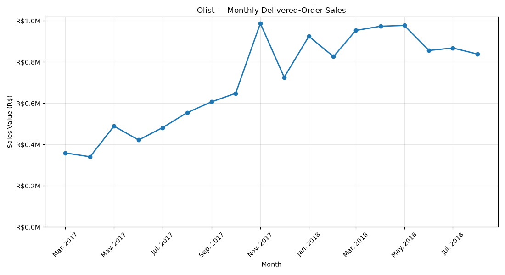
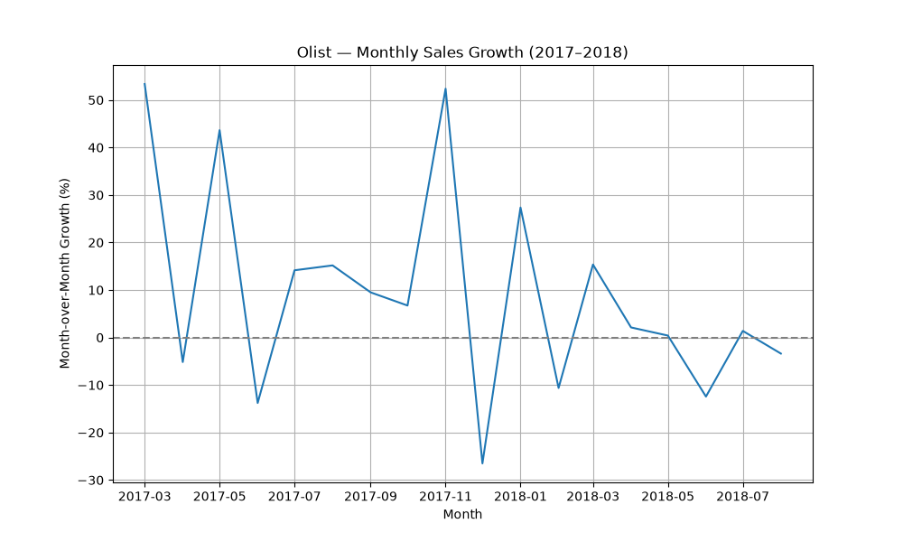

# Olist E-Commerce Sales Analytics

**SQL · Python · pandas · SQLite · Streamlit · Plotly · Matplotlib**

An end-to-end data analytics portfolio project that transforms raw Brazilian e-commerce transactions into an interactive business-performance dashboard. The analysis examines delivered-order item sales, purchasing trends, product-category performance, and geographic concentration.

**Data source:** [Olist Brazilian E-Commerce Public Dataset (Kaggle)](https://www.kaggle.com/datasets/olistbr/brazilian-ecommerce)  
**Reporting period:** January 2017 – August 2018  
**Scope:** Delivered orders; item prices excluding freight  
**Currency:** Brazilian real (BRL / R$)

## Dashboard preview



*Overview: total item sales value, delivered orders, average order value, and monthly sales trend.*



*Breakdown: top product categories, including unclassified products, and top customer states.*

> **Adding or replacing screenshots:** Save your PNGs in the `screenshots/` folder using the filenames above, or edit the relative paths in this README. GitHub will display them automatically. These screenshots show the **ALL** year selection.

## Business questions

- How did monthly delivered-order item sales value change over time?
- Were changes in sales driven by order count or average order value (AOV)?
- Which product categories contributed most to item sales value?
- Which Brazilian customer states represented the largest share of sales?
- How much sales value is linked to products with missing category labels?

## Key results

For the full January 2017–August 2018 reporting period, the dashboard shows:

| Metric | Result |
| --- | ---: |
| Total delivered-order **item sales value** | **R$13,181,027.13** |
| Delivered orders | **96,211** |
| Average order value (AOV) | **R$137.00** |
| Sales value from unclassified (`Unknown`) products | **1.29%** |
| Sales share of top three customer states | **63.39%** |

### 1. November 2017 growth was driven by more orders

Between October and November 2017, item sales value grew by approximately **52.4%**. Distinct delivered orders increased from **4,478 to 7,289** (about **62.8%**), while AOV fell from **R$144.76 to R$135.51** (about **6.4%**). Thus, higher order volume—not higher spending per order—was the principal driver of the increase.

This is a descriptive finding; the dataset alone does not establish whether promotions, seasonal shopping, or another factor caused the spike.

### 2. Several months in 2018 approached R$1 million in item sales

Item sales value reached approximately **R$977,545 in May 2018**. Monthly performance fluctuated afterward; a shorter-term decline should not be interpreted as proof of a lasting downturn.

### 3. Health & Beauty led product categories

The top three product categories by item sales value were:

1. **Health & Beauty** (`beleza_saude`)
2. **Watches & Gifts** (`relogios_presentes`)
3. **Bed, Bath & Table** (`cama_mesa_banho`)

Products without a category label are retained as **`Unknown`**, accounting for **1.29%** of item sales value. Keeping these sales in the overall totals prevents an understatement of the analyzed transaction value.

### 4. Sales were concentrated in three states

The largest customer states by item sales value were **São Paulo (SP)**, **Rio de Janeiro (RJ)**, and **Minas Gerais (MG)**. Together, they accounted for **63.39%** of item sales value. This describes geographic concentration, not necessarily market penetration or regional performance relative to population.

## Additional Python analysis

Before building the interactive dashboard, I explored the monthly data using pandas and Matplotlib.

### Monthly delivered-order item sales



### Month-over-month sales growth



*Growth is the percentage change relative to the preceding calendar month's item sales. Sparse early observations are not suitable baselines for interpreting sustained growth.*

## Methodology

1. **Inspect raw CSVs:** Review table structure, keys, missing values, and date formats.
2. **Prepare SQLite database:** Import the required Olist CSVs as relational tables.
3. **Write SQL analyses:** Join orders, items, products, and customers; calculate monthly, category, and state-level sales. Use CTEs and `LAG()` for month-over-month comparisons.
4. **Load and transform results:** Use pandas for date conversion, year filtering, category aggregation, and ranking.
5. **Build dashboard:** Use Streamlit to display three KPIs, interactive year selection (ALL / 2017 / 2018), and Plotly charts.
6. **Validate totals:** Check that the sum of item sales across customer states reconciles to the overall item-sales KPI for the same selected period.

### Metric definitions

| KPI | Definition |
| --- | --- |
| Item sales value | `SUM(order_items.price)` for orders with `order_status = 'delivered'` |
| Delivered orders | `COUNT(DISTINCT order_id)` for delivered orders with matching order items |
| Average order value | Total item sales value ÷ distinct delivered orders |
| Monthly sales growth | `(current_month_sales - previous_month_sales) / previous_month_sales × 100` |
| Top-three-state share | Item sales value of the three highest-selling customer states ÷ item sales value across all customer states |

All dashboard charts use **purchase date** for the reporting period. Item sales value excludes freight and is **not** the same as Olist's recognized platform revenue, net income, or profit.

## Project structure

```text
olist-retail-analysis/
├── dashboard.py
├── data_loader.py
├── setup_db.py
├── sql/
│   ├── monthly_sales.sql
│   ├── category_sales.sql
│   └── geographic_sales.sql
├── data/
│   ├── raw/                 # Downloaded CSVs; not committed
│   └── olist.db             # Generated locally; not committed
├── screenshots/
│   ├── dash_overview1.png
│   ├── dash_overview2.png
│   ├── monthly_delivered_orders_sales.png
│   └── monthly_sales_growth.png
├── requirements.txt
├── .gitignore
└── README.md
```

## Run locally

### 1. Clone and install dependencies

```bash
git clone https://github.com/YOUR_USERNAME/YOUR_REPOSITORY.git
cd YOUR_REPOSITORY
python -m venv .venv
source .venv/bin/activate  # macOS/Linux
python -m pip install -r requirements.txt
```

Replace `YOUR_USERNAME` and `YOUR_REPOSITORY` with your actual GitHub repository details. On Windows, activate the environment using `.venv\Scripts\activate` instead.

### 2. Download the original dataset

Download the dataset from [Kaggle](https://www.kaggle.com/datasets/olistbr/brazilian-ecommerce). Extract these files into `data/raw/`:

- `olist_orders_dataset.csv`
- `olist_order_items_dataset.csv`
- `olist_customers_dataset.csv`
- `olist_products_dataset.csv`
- `olist_sellers_dataset.csv`

### 3. Create the local SQLite database

From the repository root, run:

```bash
python setup_db.py
```

This script loads the CSVs into `data/olist.db` and creates the `orders`, `order_items`, `customers`, `products`, and `sellers` tables. With the original source files, the imported row counts should be:

| Table | Rows |
| --- | ---: |
| `orders` | 99,441 |
| `order_items` | 112,650 |
| `customers` | 99,441 |
| `products` | 32,951 |
| `sellers` | 3,095 |

Re-running the setup script replaces these imported tables. The CSVs and generated database are not tracked in Git.

### 4. Launch the dashboard

```bash
python -m streamlit run dashboard.py
```

Open the local address printed by Streamlit (usually `http://localhost:8501`) and use the sidebar to switch between **ALL**, **2017**, and **2018**.

## Limitations

- This is a **historical**, not real-time, dataset.
- Reported item sales value is not the marketplace's audited revenue, earnings, or profit.
- The principal analysis includes only orders marked as **delivered**.
- Missing product classifications are represented as `Unknown`; actual categories have not been inferred.
- Sparse months and boundaries of the observation window can distort trend comparisons.
- Observed changes and geographic concentration do not prove their underlying causes.

## Acknowledgment

Data: [Olist Brazilian E-Commerce Public Dataset](https://www.kaggle.com/datasets/olistbr/brazilian-ecommerce). This is an independent educational portfolio project and is not affiliated with Olist.
